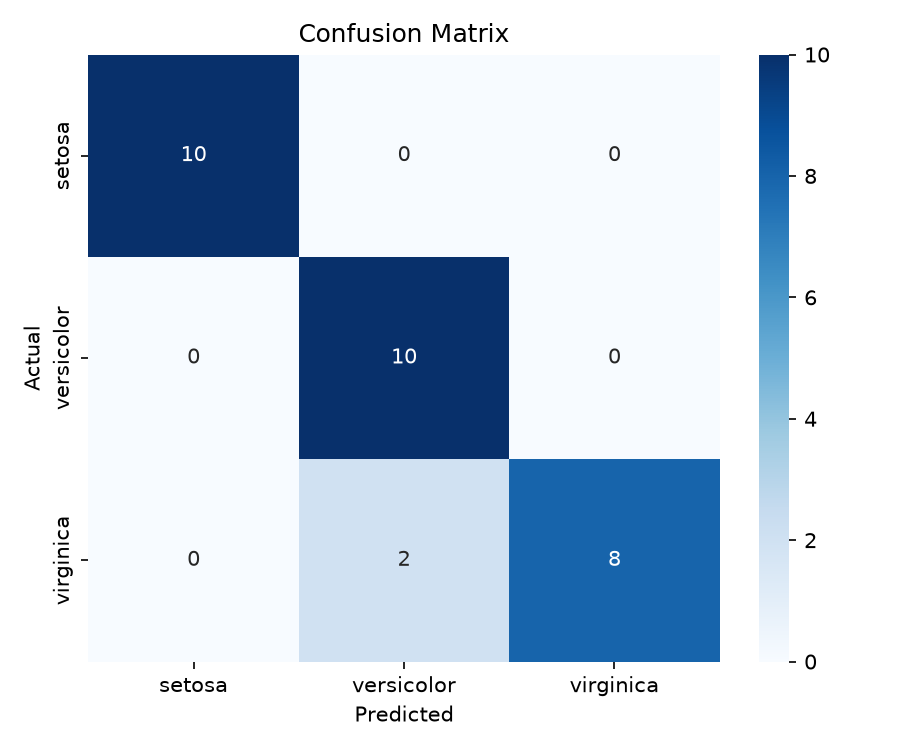
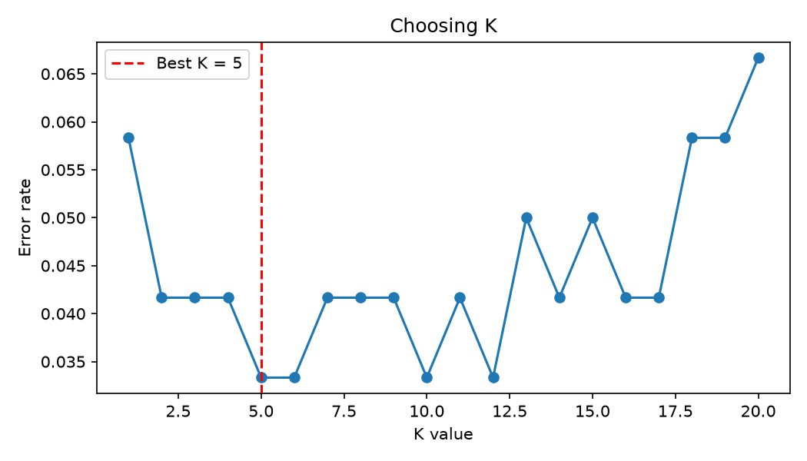

# DecodeLabs-Internship
# Data Classification Using AI (Iris + KNN)

**Project 2 – DecodeLabs AI Internship **

## Goal
Build a basic classification model that predicts the type of an Iris flower
(Setosa, Versicolor or Virginica) from its measurements, using Supervised Learning.

## Dataset
- Iris dataset (built into scikit-learn, no download needed)
- 150 samples, 3 classes (balanced), 4 features:
  sepal length, sepal width, petal length, petal width

## Algorithm
**K-Nearest Neighbors (KNN)**. A new flower is classified by looking at the K closest
flowers in the training data and taking a majority vote.

## Pipeline
1. **Load** the dataset
2. **Split** into 80% training and 20% testing (shuffled, stratified)
3. **Scale** features with `StandardScaler` (fit on training data only)
4. **Train** `KNeighborsClassifier(n_neighbors=5)` using `fit()`
5. **Predict** on the test set using `predict()`
6. **Evaluate** with accuracy, confusion matrix, classification report and F1 score
7. **Tune K** by testing K = 1 to 15

## Results
- Accuracy: ~93%
- Weighted F1 score: ~0.93
- Setosa was classified perfectly. The few mistakes were between Versicolor and Virginica,
  which look similar.

### Terminal Output(part 1)


###  Terminal Output(part 2)


### Confusion Matrix


### Choosing K


## How to Run

1. Install Python 3.8 or newer
2. Download or clone this repository
3. Open a terminal in the project folder and install the libraries:
   ```
   pip install -r requirements.txt
   ```
4. Run the project:
   ```
   python train_classifier.py
   ```
5. The results print in the terminal and two graphs open in new windows.
   Close the first graph window to see the second.

## Technologies
Python, scikit-learn, matplotlib

## What I Learned
- How supervised learning works (train, test, validate)
- Why feature scaling matters for distance-based algorithms
- Why we split data before testing the model
- How to read a confusion matrix, precision, recall and F1 score
- 
